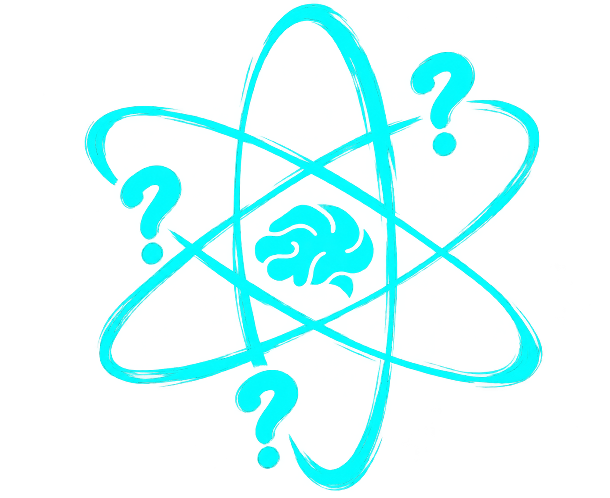

# 💡 IDEATE // The Neural Innovation & Thought Collaboration Platform

<div align="center">



[](LICENSE)
[](#)
[](#)

**A futuristic, Nothing OS-inspired ideation feed, real-time collaboration engine, and thought telemetry network for builders, researchers, and creators.**

[Explore Stream](#features) • [Getting Started](#quick-start) • [Architecture](#project-architecture) • [Design System](#design-system)

</div>

---

## 🌌 Overview

**IDEATE** is a next-generation platform designed to bring high-density creative thoughts, architectural blueprints, and abandoned ideas back into the active stream of innovation. Engineered with an obsidian dark theme, liquid water glassmorphism, and telemetry-grade responsiveness, Ideate provides an uncluttered environment for idea incubation, rapid feedback, and spontaneous team building.

---

## ✨ Key Features

- **Liquid Water Glassmorphism**: Clean, ultra-transparent frosted glass containers (`backdrop-filter: blur(24px)`) allowing atmospheric cosmic nebula art to shine through with hairline border accents.
- **Fast Idea Spawner**: Quick-broadcast input box with instant tag shortcuts (`#ML`, `#SYS`, `#QUANTUM`, `#WEB3`) and keyboard dispatch.
- **Infinite Stream Feed**: High-density idea stream cards featuring creator metadata, timestamps, role matching chips (*Seeking: Systems Architect, Math / Kernel Dev*), and interactive star systems.
- **Live Project Modal**: Interactive modal sheet displaying full deep-dive project briefs, tag matrices, collaborator count, and discussion nodes.
- **Telemetry Pulse & Most Liked Spotlight**: Real-time network telemetry grid and a dynamic "Most Liked Idea of the Day" spotlight showcase with star ranking and quick collaboration.
- **Creator Node Profile**: Complete creator hub showing sparked ideas, active war rooms, bookmarked blueprints, neural badges, and live stats.
- **Dual-Mode Authentication**: Cyber-terminal login & registration interface with real-time field validation, password reveal toggles, and seamless routing.
- **Minimalist Typography**: High-contrast typography blending **Space Grotesk** headlines, **Inter** body text, **JetBrains Mono** metadata, and **Doto** dot-matrix brand elements.

---

## 📁 Project Architecture

```plaintext
Ideate/
├── assets/
│   └── img/
│       ├── background.png      # High-definition cosmic nebula atmospheric artwork
│       └── logo.png            # Ideate signature brand icon
├── css/
│   ├── theme.css               # Central design system, tokens, and water glass utilities
│   ├── app_home.css            # Main application stream, sidebars, and modals
│   ├── profile.css             # Creator node profile layout, stats, and badges
│   ├── auth.css                # Authentication terminal and input states
│   ├── home.css                # Landing page cinematic styling
│   └── style.css               # Global base resets and root definitions
├── js/
│   ├── app_home.js             # Feed interaction, modal controller, and pull-to-refresh
│   ├── profile.js              # Tab switcher and profile actions
│   ├── auth.js                 # Form handling, validation, and session simulation
│   └── home.js                 # Landing page animations and transition manager
├── html/
│   ├── home.html               # Main application stream hub
│   ├── profile.html            # User profile and portfolio showcase
│   └── login.html              # Authentication & node access portal
├── index.html                  # Landing page hero experience
├── instruction.md              # Engineering guidelines and design system specifications
├── history.md                  # Comprehensive AI implementation changelog & trajectory
├── LICENSE                     # MIT Open Source License
└── README.md                   # Project documentation
```

---

## 🚀 Quick Start

No complex build steps, package managers, or bundlers required. IDEATE is built with pure, modern vanilla web standards.

### Option 1: Python HTTP Server (Recommended)
```bash
# Clone the repository
git clone https://github.com/ANDY0802X/Ideate.git
cd Ideate

# Start a lightweight local server
python -m http.server 8080
```
Open your browser and navigate to:
```
http://localhost:8080/
```

### Option 2: Node.js `serve` / `http-server`
```bash
npx serve .
# or
npx http-server -p 8080
```

### Option 3: VS Code Live Server
Right-click on `index.html` or `html/home.html` and select **"Open with Live Server"**.

---

## 🎨 Design System

Ideate follows a unified theme architecture defined in [`css/theme.css`](css/theme.css):

| Token | Value | Purpose |
| :--- | :--- | :--- |
| `--bg-deep` | `#04020a` | Deep obsidian background void |
| `--bg-card` | `rgba(255, 255, 255, 0.03)` | Transparent liquid water glass |
| `--bg-card-hover` | `rgba(255, 255, 255, 0.06)` | Hover state glass elevation |
| `--border-subtle` | `rgba(255, 255, 255, 0.08)` | Hairline crystal border |
| `--color-accent-violet` | `#a855f7` | Core violet action accent |
| `--font-heading` | `Space Grotesk` | Clean geometric titles & handles |
| `--font-body` | `Inter` | High-density readable body copy |
| `--font-doto` | `Doto` | Nothing OS dot-matrix brand styling |
| `--font-mono` | `JetBrains Mono` | Telemetry data & tags |

---

## 📄 License

Distributed under the **MIT License**. See [`LICENSE`](LICENSE) for complete terms.

---

<div align="center">

**IDEATE // THINK THE IMPOSSIBLE**  
*Created with craft by [ANDY0802X](https://github.com/ANDY0802X)*

</div>
